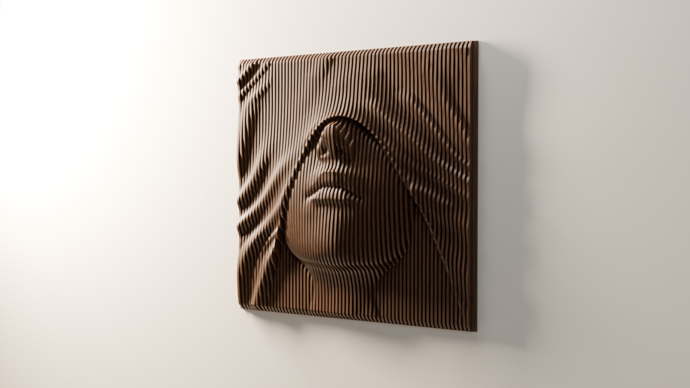
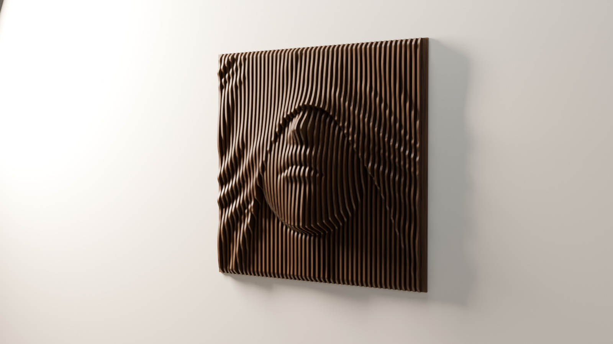
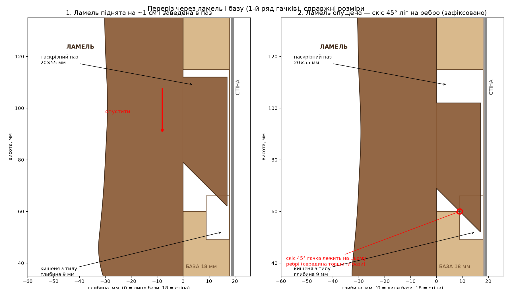
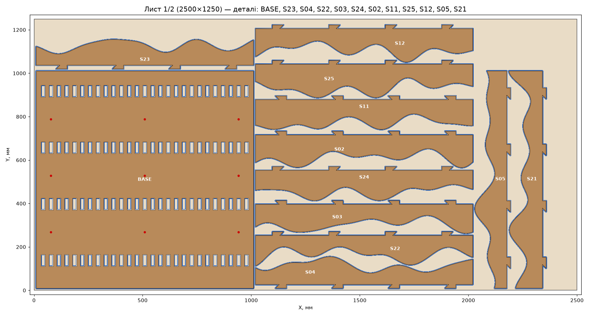
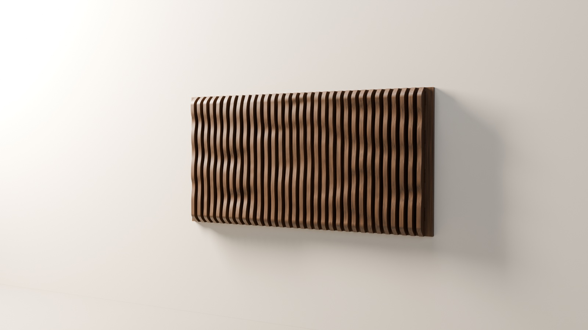
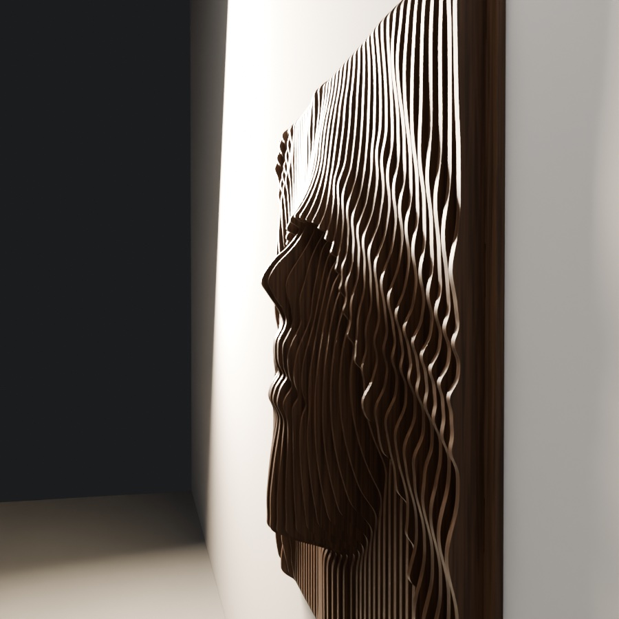

# Slat Panel from Height Map

**English** · [Українська](README.uk.md)

A [Claude Code](https://claude.com/claude-code) skill that turns a **height map** into a **parametric plywood slat wall panel**: a 3D model in Blender, studio renders and, on request, **CNC G-code (Mach3)** with the parts nested on a plywood sheet.



| Height map (input) | Panel (output) |
|---|---|
|  |  |

White on the map is closer to the viewer, black is closer to the wall. Each slat is a vertical slice of the relief.

## Features

- **Relief → slats.** The map (PNG/JPG/TIF/EXR) becomes a surface that is sliced into vertical slats of a given thickness and spacing.
- **No glue, no battens.** Every slat has 4 hooks with a 45° bevel; the base has 20×55 mm through-slots with pockets on the back. Lift a slat about 1 cm, push the hooks into the slots and drop it — the bevel locks it on the edge of the base.
- **Plywood base** screws straight to the wall through 9 countersunk holes hidden behind the slats.
- **Scene and renders.** Matte plaster wall, concrete floor, warm raking light from the left (it is what makes the relief read), walnut material, Cycles + AgX. A preview takes about 20 s, then FullHD and 4K.
- **Production (Mach3).** Nesting on a 2500×1250 (or 1500×1500) sheet, 6 mm end mill, holding tabs, a front program plus a back program for the base, DXF files, PNG layouts with the real toolpath and a time estimate.

| Hook and slot cross-section | CNC sheet layout |
|---|---|
|  |  |

The diagrams are labelled in Ukrainian; dimensions are in millimetres.

## Gallery





## Installation

```bash
git clone https://github.com/faeriy/slat-panel-from-heightmap ~/.claude/skills/slat-panel-from-heightmap
```

Restart Claude Code and the skill is picked up automatically.

**Requirements:**

- [Blender](https://www.blender.org/) (tested on 5.2) — the script runs headless. The default path is `/Applications/Blender.app/Contents/MacOS/Blender` (macOS); use your own on other systems.
- [uv](https://docs.astral.sh/uv/) — only for the CNC export (`shapely`, `ezdxf` and `matplotlib` are installed on the fly).
- Blender MCP — optional; only needed to open the finished `.blend` in a running Blender.

## Usage

Drop an image into Claude and ask, for example:

> make a slat panel from this height map
>
> nest it on a sheet and give me G-code for the CNC

The skill renders a preview first, checks the relief is not inverted, then runs the full render. Its instructions (`SKILL.md`) are in English, while the CNC operator notes it produces are in Ukrainian.

### Manually, without Claude

```bash
# 1. Model + renders
Blender -b --factory-startup --python build_panel.py -- \
  --input map.png --out out/my_panel --name my_panel --render preview   # or full

# 2. CNC files
uv run --no-project --with shapely --with ezdxf --with matplotlib python \
  export_cnc.py --geom out/my_panel/cnc_geometry.json --out out/my_panel/CNC
```

### Main parameters (`build_panel.py`, in metres)

| flag | default | meaning |
|---|---|---|
| `--width` / `--height` | 1.0 / 1.0 | panel size |
| `--thickness` | 0.018 | plywood thickness (slats and base) |
| `--gap` | 0.018 | gap between slats |
| `--min-depth` / `--amp` | 0.05 / 0.12 | depth on black + extra depth on white |
| `--end-fade` / `--end-depth` | 0 / 0.02 | ease the relief out at the slat ends |
| `--smooth` | 0 | blur the map (σ, px) — removes steps on 8-bit maps |
| `--invert` | — | invert the map |
| `--profile-res` | 240 | profile points per metre; use 1000 for production |

Good starting values for a calm 2–5 cm relief:
`--min-depth 0.02 --amp 0.03 --end-fade 0.04 --end-depth 0.015 --smooth 10 --profile-res 1000`.

### CNC settings (`export_cnc.py`)

Sheet `--sheet 2500x1250`, end mill `--tool 6`, step-down `--stepdown 1.5`, final depth `--through 18.5`, feed `--feed 1500`, plunge `--plunge 300`, `--rpm 18000`, 8×3 mm tabs. Z0 is the top of the sheet, X0Y0 its bottom-left corner.

> ⚠️ Check the G-code in a simulator (or on an offcut) before cutting a full sheet. Measure the real plywood thickness — the slots and pockets depend on it.

## Layout

```
SKILL.md                      instructions for Claude
build_panel.py                Blender: map → slats, base, scene, renders, cnc_geometry.json
export_cnc.py                 sheet nesting → Mach3 .tap + DXF + PNG
templates/README_для_ЧПК.txt  CNC operator notes template (Ukrainian)
images/                       pictures for this README
```

## License

[MIT](LICENSE)
