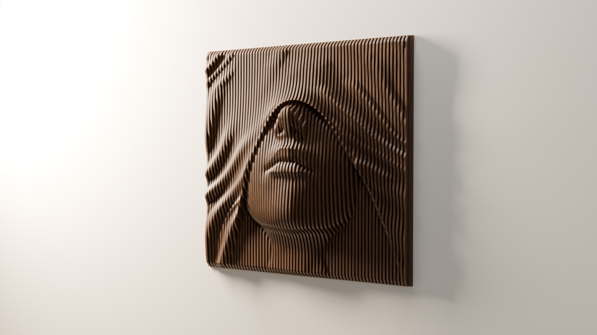
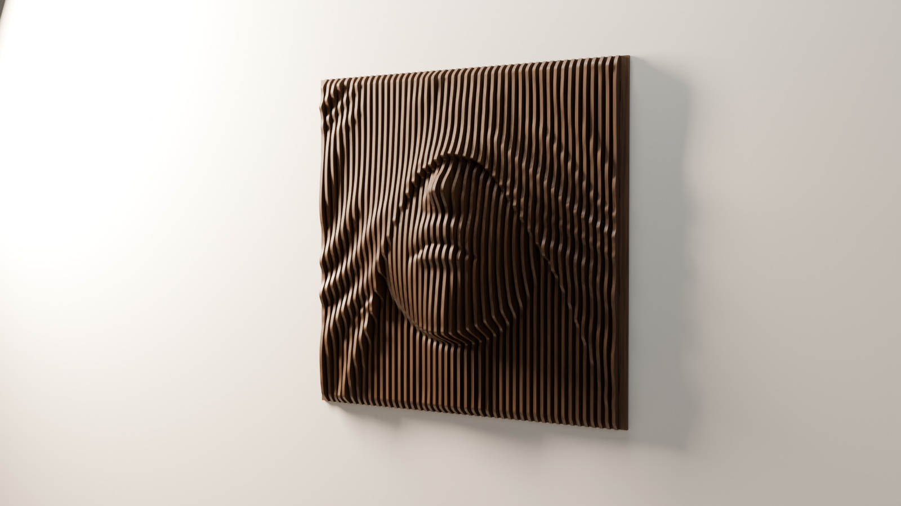
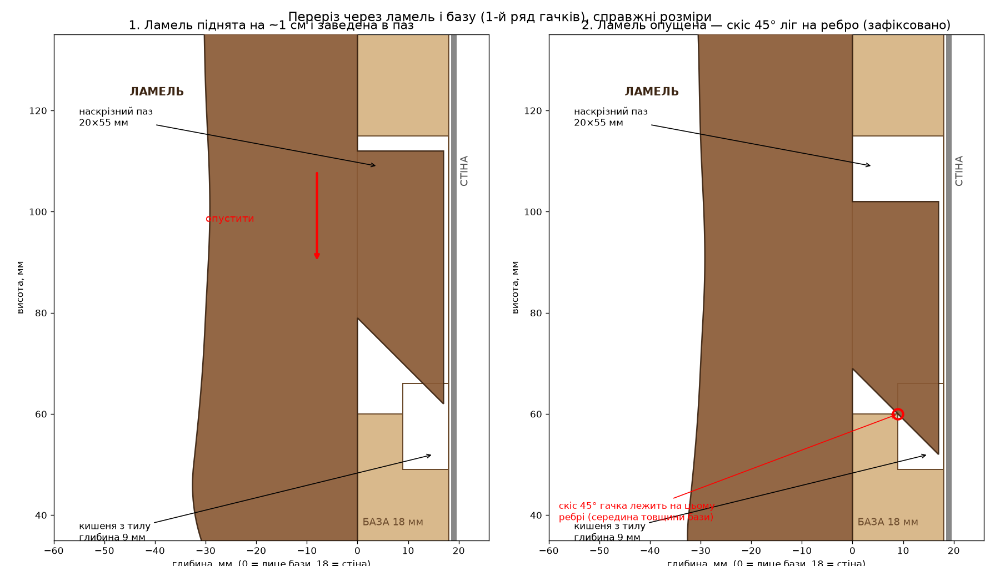
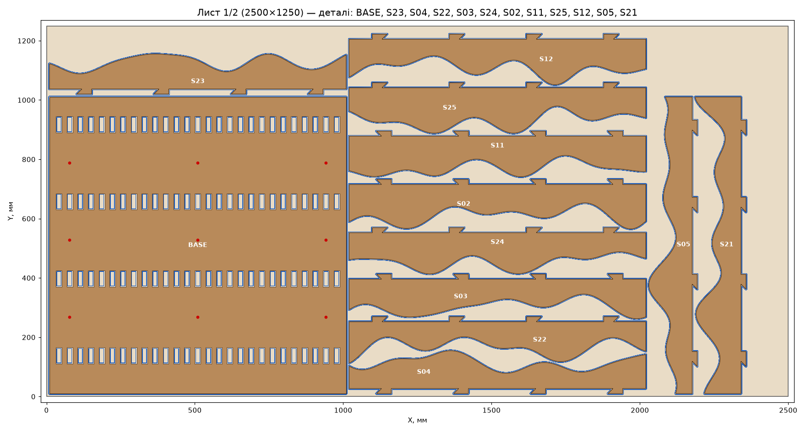
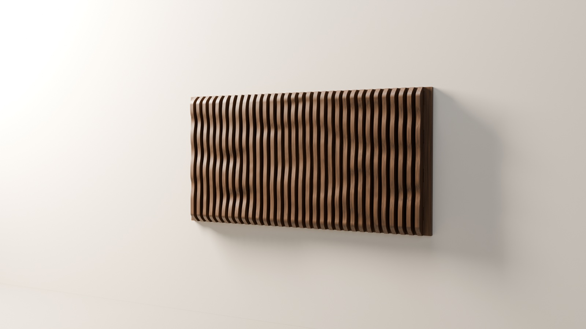
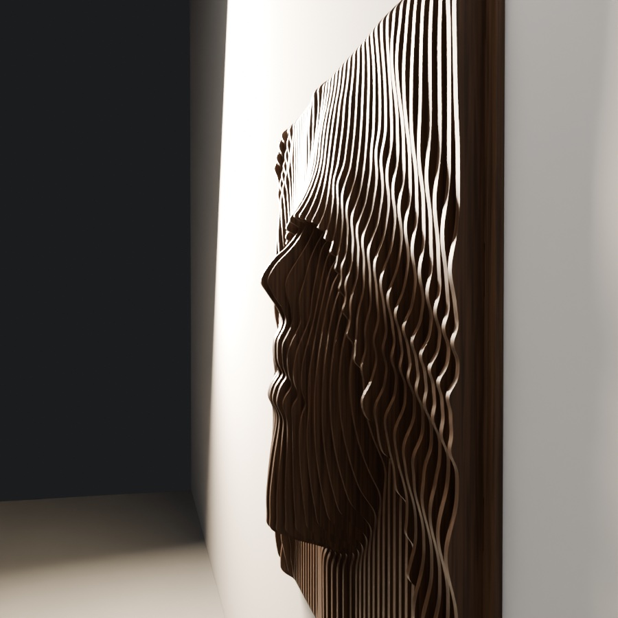

# Slat Panel from Height Map

[English](README.md) · **Українська**

Скіл для [Claude Code](https://claude.com/claude-code): з **карти висот** робить **параметричну панель із фанерних ламелей** — 3D-модель у Blender, студійні рендери і, за потреби, **G-код для ЧПК (Mach3)** з розкладкою деталей на лист.



| Карта висот (вхід) | Панель (результат) |
|---|---|
|  |  |

Біле на карті — ближче до глядача, чорне — до стіни. Кожна ламель — це вертикальний «зріз» рельєфу.

## Що вміє

- **Рельєф → ламелі.** Карта (PNG/JPG/TIF/EXR) перетворюється на поверхню, яка ріжеться на вертикальні ламелі заданої товщини й кроку.
- **Кріплення без клею й рейок.** На кожній ламелі 4 гачки зі скосом 45°, у базі — наскрізні пази 20×55 мм і кишені з тилу. Ламель піднімаєш на ~1 см, заводиш у паз і опускаєш — скіс фіксує її на ребрі бази.
- **База** з фанери кріпиться прямо до стіни через 9 отворів під потай, сховані за ламелями.
- **Сцена і рендери.** Матова стіна, бетонна підлога, косе тепле світло зліва (саме воно «малює» рельєф), горіх, Cycles + AgX. Превʼю за ~20 с, далі FullHD і 4K.
- **Виробництво (Mach3).** Розкладка деталей на лист 2500×1250 (або 1500×1500), фреза 6 мм, містки, лицьова програма + програма для тилу бази, DXF і PNG розкладки з траєкторією фрези, оцінка часу.

| Переріз гачка і паза | Розкладка на лист для ЧПК |
|---|---|
|  |  |

## Галерея





## Встановлення

```bash
git clone https://github.com/faeriy/slat-panel-from-heightmap ~/.claude/skills/slat-panel-from-heightmap
```

Перезапусти Claude Code — скіл підхопиться сам.

**Потрібно:**

- [Blender](https://www.blender.org/) (перевірено на 5.2) — скрипт запускається headless, шлях за замовчуванням `/Applications/Blender.app/Contents/MacOS/Blender` (macOS; на інших ОС підстав свій).
- [uv](https://docs.astral.sh/uv/) — тільки для експорту під ЧПК (`shapely`, `ezdxf`, `matplotlib` ставляться на льоту).
- Blender MCP — необовʼязково; потрібен лише щоб відкрити готовий `.blend` у запущеному Blender.

## Як користуватись

Просто кинь Claude картинку й напиши, наприклад:

> зроби панель з цієї карти висот
>
> розклади на лист і дай G-код для ЧПК

Скіл сам зробить превʼю, перевірить, чи рельєф не інвертований, і запустить повний рендер.

### Вручну, без Claude

```bash
# 1. Модель + рендери
Blender -b --factory-startup --python build_panel.py -- \
  --input map.png --out out/my_panel --name my_panel --render preview   # або full

# 2. Файли для ЧПК
uv run --no-project --with shapely --with ezdxf --with matplotlib python \
  export_cnc.py --geom out/my_panel/cnc_geometry.json --out out/my_panel/CNC
```

### Основні параметри (`build_panel.py`, у метрах)

| прапорець | за замовч. | що це |
|---|---|---|
| `--width` / `--height` | 1.0 / 1.0 | розмір панелі |
| `--thickness` | 0.018 | товщина фанери (ламелі й база) |
| `--gap` | 0.018 | проміжок між ламелями |
| `--min-depth` / `--amp` | 0.05 / 0.12 | глибина на чорному + додаток на білому |
| `--end-fade` / `--end-depth` | 0 / 0.02 | плавне згасання рельєфу на кінцях ламелі |
| `--smooth` | 0 | розмиття карти (σ, px) — проти «сходинок» на 8-бітних картах |
| `--invert` | — | інвертувати карту |
| `--profile-res` | 240 | точок профілю на метр; 1000 — для виробництва |

Хороші стартові значення для «спокійного» рельєфу 2–5 см:
`--min-depth 0.02 --amp 0.03 --end-fade 0.04 --end-depth 0.015 --smooth 10 --profile-res 1000`.

### Режими ЧПК (`export_cnc.py`)

Лист `--sheet 2500x1250`, фреза `--tool 6`, крок `--stepdown 1.5`, глибина `--through 18.5`, подача `--feed 1500`, врізання `--plunge 300`, `--rpm 18000`, містки 8×3 мм. Z0 — верх листа, X0Y0 — лівий нижній кут.

> ⚠️ G-код перевір у симуляторі (або на обрізку) перед порізкою цілого листа. Виміряй реальну товщину фанери — від неї залежать пази й кишені.

## Структура

```
SKILL.md                    інструкції для Claude
build_panel.py              Blender: карта → ламелі, база, сцена, рендери, cnc_geometry.json
export_cnc.py               розкладка на лист → Mach3 .tap + DXF + PNG
templates/README_для_ЧПК.txt  шаблон інструкції для оператора ЧПК
images/                     картинки для цього README
```

## Ліцензія

[MIT](LICENSE)
